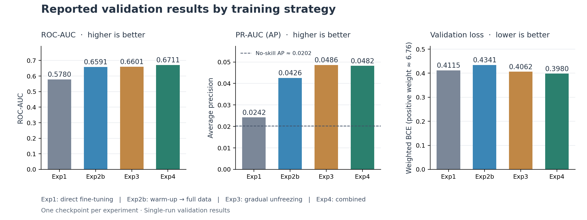

# Mammography Classification with Transfer Learning

[](https://github.com/Christina77Li/mammography-transfer-learning/actions/workflows/tests.yml)

A comparison of four fine-tuning strategies for ImageNet-pretrained **ResNet101** on the highly imbalanced RSNA screening mammography dataset. This project explores how early class distribution and progressive backbone adaptation affect image-level cancer classification.

## What this project demonstrates

- **Data integrity:** CSV/PNG checks and disjoint breast-group split validation before training.
- **Checkpoint traceability:** matching weights, metrics and epochs through transfer and stage rollback.
- **Engineering validation:** modular training, regression tests and a ResNet101 smoke test in CI.

For a visual walkthrough, [view the research presentation (PDF)](docs/slides/research_presentation.pdf).

## Results

Each experiment row reports ROC-AUC, average precision and validation loss from the same checkpoint. All four losses use positive-weighted BCE with `pos_weight ≈ 6.76`.

| Experiment | Training strategy | ROC-AUC ↑ | PR-AUC (AP) ↑ | Val. loss ↓ |
| --- | --- | ---: | ---: | ---: |
| Exp1 | Baseline: direct full-data fine-tuning | 0.5780 | 0.0242 | 0.4115 |
| Exp2b | 1:3 subset warm-up → full-data transfer | 0.6591 | 0.0426 | 0.4341 |
| Exp3 | Gradual unfreezing | 0.6601 | **0.0486** | 0.4062 |
| Exp4 | Warm-up → head recalibration → gradual unfreezing | **0.6711** | 0.0482 | **0.3980** |
| Random reference | No-skill reference at 2.02% validation prevalence | 0.5000 | ≈ 0.0202 | — |

Exp1's AP is only slightly above the no-skill reference; Exp4's AP is approximately **2.38×** that reference. This ratio describes average precision, not a clinical detection rate.



The combined strategy achieved the highest ROC-AUC and lowest loss among these checkpoints. Gradual unfreezing alone had the highest PR-AUC. The best ROC-AUC stages were **layer2 for Exp3** and **layer3 for Exp4**. See [experiment details](docs/experiments.md) for the training stages and additional checkpoints.

## Training design

Warm-up uses a positive-enriched subset sampled from training groups. Exp2a updates the whole model; Exp4's warm-up updates the head only. Full-data validation remains fixed. Gradual unfreezing trains the head first, then releases `layer4 → layer3 → layer2 → layer1 → conv1`, with smaller learning rates for earlier blocks and selected-checkpoint rollback at stage transitions.

The training pipeline uses AdamW, phase-specific BCE/positive-weighted BCE, plateau scheduling and loss-constrained checkpoint selection; Exp3–4 freeze BatchNorm statistics. Warm-up losses use ordinary BCE and must not be compared directly with the weighted full-data losses.

## Quick start

**Python 3.12 · CPU** — create a virtual environment, then run:

```bash
python -m pip install torch==2.10.0 torchvision==0.25.0 --index-url https://download.pytorch.org/whl/cpu
python -m pip install -r requirements-dev.txt
python -m pytest -q
python scripts/smoke_test.py
```

The smoke test trains ResNet101 on synthetic PNGs for one epoch, reloads its checkpoint and verifies the metrics. It needs no dataset or pretrained-weight download. [Setup instructions](docs/setup.md) include Windows commands, CUDA installation and input preparation.

To train with your dataset:

```bash
python scripts/train.py --config configs/exp1_baseline.yaml --check
python scripts/train.py --config configs/exp1_baseline.yaml --output-dir outputs/exp1_new_run
```

Exp2 and Exp4 configurations request CUDA; add `--device cpu` when needed. Exp3 chooses an available device automatically. Exp2b requires the selected Exp2a checkpoint. Paths resolve from the project root; use a new output directory for each run.

## Evaluation and project structure

Results are single-run validation measurements without confidence intervals, significance testing or external validation. The split groups by **patient ID + laterality**, keeping views of one breast together; it does not guarantee that both breasts of every patient share a partition. These results do not establish clinical screening performance.

Validation also drives learning-rate scheduling, stage transitions and checkpoint selection, so these scores are development results rather than estimates from an untouched test set. Stage learning rates and loss tolerances are experimental settings, not established optimal values.

Inputs are resized to **256 × 256 because of compute constraints**; this can discard fine detail relevant to small lesions and calcifications. Future work includes higher-resolution or patch-based inputs, patient-level splits, an untouched test set and repeated-seed evaluation.

The configurations use `deterministic: false`; reruns can vary even with a fixed seed, particularly on GPU.

| Path | Purpose |
| --- | --- |
| `configs/` | Experiment configurations |
| `src/` | Data loading, model, training and evaluation |
| `scripts/` | Training, DICOM conversion, smoke test and plotting |
| `tests/` | Data, configuration and checkpoint regression tests |
| `results/` | Experiment metrics and figures |
| `docs/` | Setup, experiments and checkpoint behavior |

Regenerate figures with `python scripts/plot_reported_results.py`. Datasets, weights and run outputs are excluded from Git. [Training architecture](docs/training_architecture.md) explains the execution routes; [checkpoint documentation](docs/config_and_checkpoints.md) describes selection and weight transfer; [test documentation](docs/verification.md) explains automated validation.

## License and data

Code is available under the [MIT License](LICENSE). RSNA data is subject to the [competition rules](https://www.kaggle.com/competitions/rsna-breast-cancer-detection/rules); this repository does not distribute the dataset.

**Author:** Ruijing Li · Sophia University
