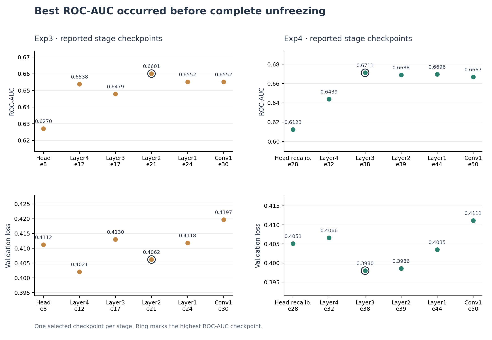
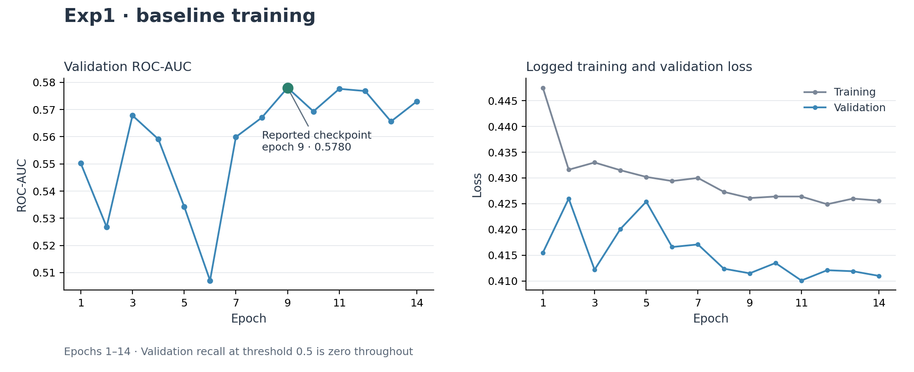

# Experiments

## Training strategies

| Experiment | Configuration | Strategy |
| --- | --- | --- |
| Exp1 | `configs/exp1_baseline.yaml` | Direct full-data fine-tuning |
| Exp2a | `configs/exp2a_subset_warmup_1to3_auc_loss_guard.yaml` | Full-model warm-up on a positive-enriched subset |
| Exp2b | `configs/exp2b_from_exp2a_selected_epoch4.yaml` | Full-data transfer from the selected Exp2a checkpoint |
| Exp3 | `configs/exp3m_late_stage_auc_tolerance_rollback.yaml` | Gradual unfreezing |
| Exp4 | `configs/exp4_1to3_head_warmup_loss_guard_fixed_tolerance.yaml` | Head warm-up, full-data recalibration and gradual unfreezing |

All configurations use AdamW. Warm-up sampling targets three negative groups per positive group; the resulting image ratio can differ from 1:3. Validation stays fixed throughout training. Checkpoints are selected by ROC-AUC subject to validation-loss bounds.

Exp1 fine-tunes the full ResNet101 with batch size 128, a maximum of 100 epochs, learning rate 0.001 and weight decay 0.0005. Its ReduceLROnPlateau scheduler uses patience 3 and factor 0.5.

## Data and preprocessing

| Partition | Positive images | Negative images | Total | Positive fraction |
| --- | ---: | ---: | ---: | ---: |
| Training | 936 | 42,792 | 43,728 | 2.14% |
| Validation | 222 | 10,756 | 10,978 | 2.02% |
| Warm-up subset | 936 | 2,767 | 3,703 | 25.28% |

The split groups by patient ID and laterality. Training uses rotation, horizontal flipping and ImageNet normalization; validation uses deterministic transforms. The configurations resize PNG inputs to 256 × 256. The DICOM converter applies polarity correction, per-image min–max normalization and resizing; it does not apply VOI windowing or modality LUTs.

## Warm-up and transfer checkpoints

| Phase | Checkpoint | Epoch | ROC-AUC | PR-AUC (AP) | Val. loss |
| --- | --- | ---: | ---: | ---: | ---: |
| Exp2a | Highest AUC | 7 | 0.6487 | 0.0385 | 0.3016 |
| Exp2a | Selected transition | 4 | 0.6436 | 0.0347 | 0.2644 |
| Exp2b | Loss-controlled alternative | 3 | 0.6487 | 0.0390 | 0.4207 |
| Exp4 warm-up | Highest AUC | 20 | 0.6086 | 0.0322 | 0.3452 |
| Exp4 warm-up | Selected transition | 17 | 0.6026 | 0.0320 | 0.3284 |

Exp2b starts from the selected Exp2a transition checkpoint and uses positive-weighted BCE on full data. Exp4 performs head recalibration before gradually unfreezing the backbone. The main results are in `results/reported_metrics.csv`; additional checkpoints are in `results/additional_checkpoints.csv`.

## Gradual unfreezing

Each point is a selected stage checkpoint. The ring marks the highest ROC-AUC checkpoint for that experiment. Later stages can improve PR-AUC without improving ROC-AUC: Exp4's conv1 checkpoint has PR-AUC 0.0550, ROC-AUC 0.6667 and loss 0.4111. Its metrics belong to that checkpoint and are not combined with the layer3 result.

## Baseline training

Exp1's selected checkpoint is epoch 9. At threshold 0.5, validation accuracy is 0.9798 while recall is zero, showing why accuracy alone is insufficient under severe class imbalance. Thresholds selected on validation data require separate evaluation before deployment.

## Evaluation scope

The results compare single training runs on a fixed validation partition. Validation-based selection does not replace an untouched test set or external validation. Actual settings and checkpoint paths for a new execution are defined in its configuration; changes to data, seeds or training settings can change its results.
